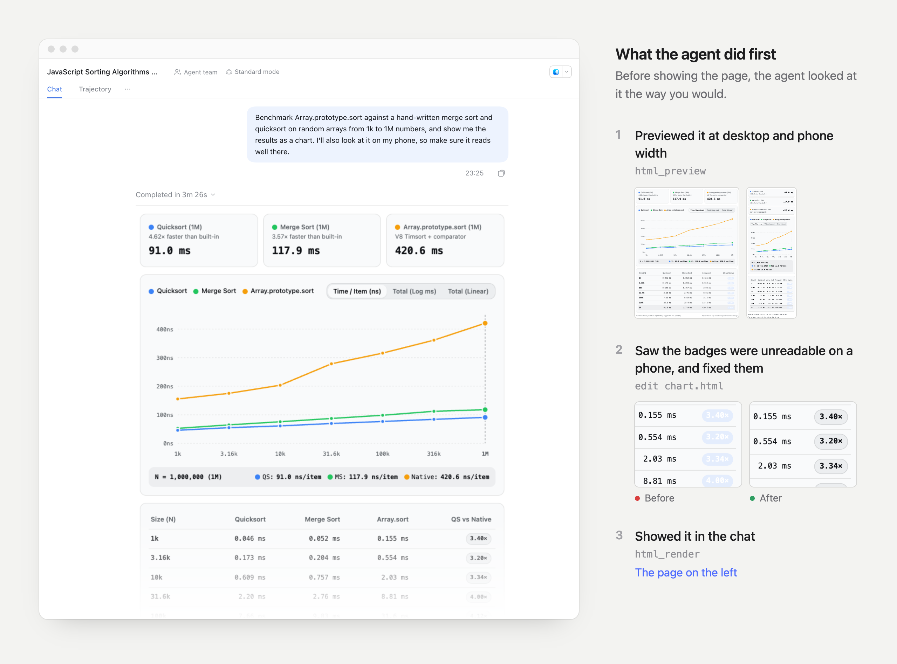

# DSH HTML Render

Lets agents in [DSH](https://www.npmjs.com/package/@deepseek-ai/dsh) answer with
a page: a chart, table, diagram or mockup shown right in the chat. The agent
checks the page in headless Chrome first, so it sees what you will see and fixes
it before you do.



*A real session: asked for a benchmark chart that also reads well on a phone,
the agent caught unreadable badges in its own phone-width preview and fixed
them before rendering. The before/after crops are re-rendered at higher
resolution from the session's two versions of the page.*

Needs DSH 0.2.x (0.2.2-alpha.2 or later) and, for previews, Google Chrome or
Chromium on the machine running DSH. MIT licensed.

## Install

**Plugins page** (DSH Web or Desktop): open **Plugins** in the sidebar, choose
**Add plugin**, paste this address and install:

```
https://github.com/aur3l14no/dsh-html-render/releases/download/v0.1.2/dsh-html-render-0.1.2.tgz
```

**Terminal** (a CLI Web profile):

```sh
dsh plugin --profile web add https://github.com/aur3l14no/dsh-html-render/releases/download/v0.1.2/dsh-html-render-0.1.2.tgz
dsh web
```

**Ask an agent**: paste this into DSH (Creator mode), Claude Code, Codex or any
coding agent:

```
Install the DSH plugin dsh-html-render by following
https://raw.githubusercontent.com/aur3l14no/dsh-html-render/HEAD/docs/install.md
```

Then ask for something visual, for example *"chart this CSV"* or *"show the
two layouts side by side"*.

## What you see

- The page appears **where the agent called `html_render`**: text the agent
  writes afterwards sits below it. When the turn's tool calls fold away, the
  page stays.
- It follows your DSH theme, light or dark, and switches live with it.
- The frame fits the page's height (up to 20,000px). Hover it to open it full
  screen. Links open in a new browser tab.
- Each tool call has a compact row. Expand a preview row to see the screenshot
  the agent got, its result and the page source.

## What the agent sees

Two tools. Their descriptions and schemas, in [`index.js`](index.js), are the
whole contract.

| Tool | Takes | Returns to the agent |
| --- | --- | --- |
| `html_preview` | `path` or `html`, `width` (240 to 1600, default 728; about 390 for phones), `appearance` (`light` or `dark`) | A PNG of the page as the chat frame would show it, its `contentHeight`, layout problems and console output. The PNG is attached only for models that accept images. |
| `html_render` | `path` or `html`, `title`, `height` (80 to 2000, normally the previewed `contentHeight`) | One line: `Rendered "<title>" for the user.` or the reason it refused the page. |

`html_preview` is the agent's own check: it looks at the screenshot, edits the
page and previews again until it is right, and only then calls `html_render`.

Pass `path`, the absolute path of an `.html` file, or the page itself as
`html`. With `path` the agent writes the page once and then edits it with its
usual file tools; previews and the render pass only the path. `html_render`
reads the file once, at the call: later edits do not change the page already
shown, and showing a new version takes another `html_render`.

The two tool definitions add about 3,200 characters (roughly 800 tokens) to
each agent. Each preview adds a short text result and one screenshot; each
render adds one line.

## Writing pages

The `html_render` description tells the agent these rules; they are listed here
for anyone writing pages by hand.

- **Self-contained.** Inline `<style>` and `<script>`. Remote URLs (a CDN chart
  library, web fonts) load as-is.
- **Local images by absolute path.** Any quoted absolute path or `file://` URL
  to an image (in an attribute, CSS `url()` or a script string) is read and
  inlined as a data URI: at most 1 MB each and 2 MB per page. A file that is
  not really an image is never inlined, and `html_render` refuses a page with
  images it cannot read.
- **Theme variables.** Use the CSS variables on `:root` instead of fixed
  colors: `--background`, `--foreground`, `--muted`, `--card`, `--popover`,
  `--secondary`, `--border`, `--ring`, `--primary`, `--accent`,
  `--destructive`, `--warning`, `--success`, `--info`, `--code-background`
  (most with `-foreground`; `accent`, `destructive` and `warning` also with
  `-surface`), `--chart-1` to `--chart-6`, `--radius`, `--font-sans`,
  `--font-mono`.
- **Layout.** The frame is the reply's width (about 728px on desktop, 360px on
  phones) on the chat background, with an 8px padding you can override. Leave
  `html` and `body` without a background or outer card. Let content set the
  height: `vh` units and `height: 100%` on `html` or `body` are refused,
  because the frame grows to fit them.
- **Size.** A page passed as a file is at most 512,000 characters, like one
  passed inline.

## Security

The page runs in a `srcdoc` iframe with `sandbox="allow-scripts allow-forms"`
and no `allow-same-origin`, so it has an opaque origin. It cannot read DSH's
page, cookies or storage, or call DSH's API as you. It cannot open pop-ups or
navigate the DSH window; DSH opens only http(s) links it is handed, in a new
tab. The page can still reach the network.

`path` reads files through the session's filesystem. DSH restricts writes, not
reads, so this gives the agent nothing its shell could not already read.

## Configuration

Set this on the `html-render` entry in the profile's `cordis.patch.yml`:

```yaml
- id: html-render
  config:
    browserPath: /usr/bin/chromium
```

| Option | Default | Meaning |
| --- | --- | --- |
| `browserPath` | `''` | Chrome or Chromium binary for `html_preview`. Empty uses the installed Google Chrome. |

The browser starts on the first preview and closes after a minute without one.
`html_render` does not need it: without a browser, previews fail with an
explanation and pages still render.

## Limitations

- Pages rendered through `run_code` (PTC mode) do not appear in the chat.
- The preview uses a recorded copy of the DSH theme, so its colors can drift
  from the chat's after a DSH upgrade until the plugin re-records them.
- Pages can reach the network; the sandbox isolates DSH, not the internet.

## Development

See [CONTRIBUTING.md](CONTRIBUTING.md) for building, testing, following DSH
and T3 Code upstream, and releasing.

## Acknowledgements

The design comes from the `html_preview` and `html_render` tools in
[T3 Code](https://github.com/pingdotgg/t3code): the tool shapes, theme
variables and layout rules match T3's, so a page written for one works in the
other. Parts of the page-file and image checks are ported from it; see
[THIRD_PARTY_NOTICES.md](THIRD_PARTY_NOTICES.md).

## License

[MIT](LICENSE).
